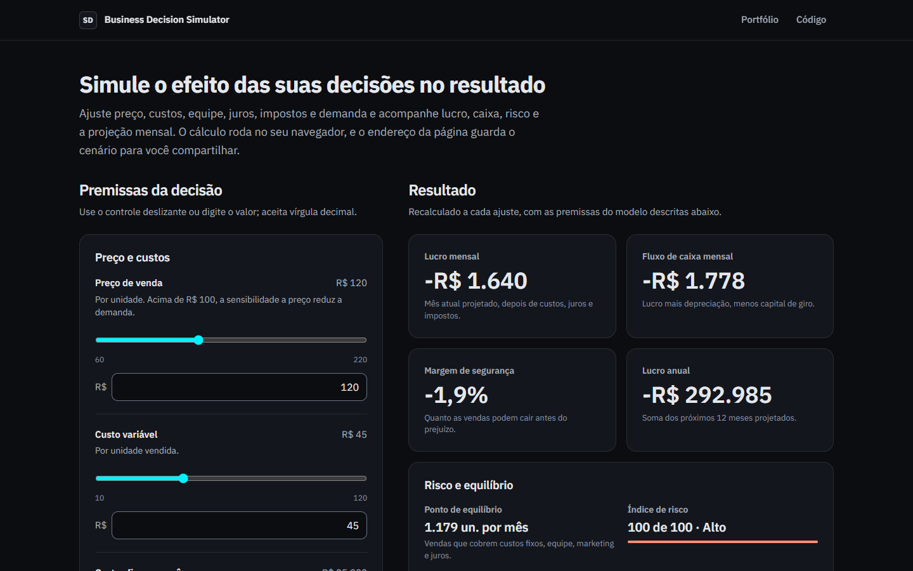

# Business Decision Simulator

Simulador web de decisões de negócio: ajuste preço, custos, equipe, juros, impostos e demanda e veja lucro, caixa, risco e a projeção mensal recalculados no navegador.

[](https://simulacao-estrategica-decisao.vercel.app)
[](https://www.matheussiqueira.dev/pt-BR/projects/business-decision-simulator)
[](https://github.com/matheussiqueira-dev/Simulacao-Estrategica-de-Decisao-Empresarial)



---

## O que faz
- **Simula a decisão no navegador:** cada ajuste de preço, custo, equipe, marketing, demanda, churn, juros ou impostos recalcula na hora o lucro, o fluxo de caixa, a margem de segurança, o risco e a projeção mensal. Não há chamada de rede.
- **Um modelo só:** KPIs e projeção usam a mesma demanda efetiva (demanda × efeito do preço). O lucro mensal é o primeiro mês projetado e o lucro anual é a soma dos próximos 12 meses.
- **Entradas tolerantes a erro:** campo vazio ou texto inválido mostram erro inline e mantêm o último resultado; valores fora da faixa são limitados aos extremos; aceita vírgula decimal.
- **Cenário compartilhável:** os valores alterados vão para o endereço da página (`?price=150&demand=2000`); abrir o link restaura o cenário, e valores inválidos são descartados ou limitados.
- **Premissas à vista:** salário por pessoa, dívida, capital de giro, depreciação, efeito do preço e sazonalidade aparecem na página.
- **Acessível:** labels visíveis, foco visível, gráfico com tabela alternativa e sem animação com `prefers-reduced-motion`. O axe roda em 320, 768 e 1280 px no CI.

## Stack
- **Frontend (publicado):** Next.js 16 (App Router, página estática), React 19, TypeScript strict, Tailwind 3 com o design system `ms-tokens` v1.0, IBM Plex Sans, Recharts 3, ícones Lucide (`lucide-react` 1.55.0, versão fixa do padrão).
- **Testes:** Vitest (motor, entradas, formatação e tokens), Playwright com `@axe-core/playwright` (fluxos, overflow e acessibilidade).
- **Backend (referência, não publicado):** FastAPI e Pydantic v2 com o mesmo motor em Python, usado para os testes de paridade; pytest e ruff.

## Arquitetura
- `frontend/src/lib/simulation/` — motor (`engine.ts`), limites das entradas, parser pt-BR, formatação BRL e cenário na URL. É a fonte das fórmulas que a página usa.
- `frontend/src/app/` — página, layout com o shell padrão, componentes, ícone, imagens de compartilhamento, `robots.txt` e `sitemap.xml`.
- `backend/app/simulation/engine.py` — implementação de referência do mesmo motor.
- `fixtures/simulation-golden.json` — 13 cenários que os dois motores precisam reproduzir (gerados por `backend/scripts/generate_golden.py`).
- `docs/adr/` — decisões de arquitetura, modelo, CSP e persistência.

## O modelo
| Métrica | Como é calculada |
|---|---|
| Demanda efetiva | demanda mensal × fator de preço (entre 0,6 e 1,3; cai acima de R$ 100 conforme a sensibilidade) |
| Lucro mensal | primeiro mês projetado: (preço − custo variável) × demanda efetiva − custos fixos − folha − marketing − juros − impostos |
| Lucro anual | soma dos próximos 12 meses projetados |
| Fluxo de caixa mensal | lucro mensal + depreciação − capital de giro diluído no horizonte |
| Ponto de equilíbrio | (custos fixos + folha + marketing + juros) ÷ margem de contribuição |
| Margem de segurança | (demanda efetiva − ponto de equilíbrio) ÷ demanda efetiva |
| Índice de risco | 1 − margem de segurança, limitado entre 0 e 1 |
| Projeção | demanda efetiva × tendência (crescimento mensal do modelo, nunca abaixo de zero) × sazonalidade de ±8% |

É um modelo simplificado para demonstração e não substitui uma análise financeira.

## Como rodar localmente
Requisitos: Node 24 (`frontend/.nvmrc`). O backend é opcional e usa Python 3.12 (`backend/.python-version`).

```bash
cd frontend
npm ci
npm run dev
```

API de referência (opcional):
```bash
cd backend
python -m venv .venv
. .venv/Scripts/activate   # Windows
pip install -r requirements-dev.txt
uvicorn app.main:app --reload --port 8000
```

## Testes
```bash
cd frontend
npm run lint
npm run typecheck
npm test            # Vitest com cobertura
npm run build
npm run test:e2e    # Playwright + axe contra o build; localmente usa o Edge instalado
```

```bash
cd backend
ruff check .
python -m pytest
```

Ao mudar uma fórmula, altere `engine.ts` e `engine.py` juntos e regenere as fixtures com `python scripts/generate_golden.py` (na pasta `backend`). O CI roda tudo isso em cada PR e em cada push na `main`.

## Deploy na Vercel
- Projeto `simulacao-estrategica-decisao`, conectado ao GitHub: cada push gera um preview e a `main` vai para produção.
- **Root Directory:** `frontend`. **Preset:** Next.js. **Node:** 24.x.
- **Env vars:** nenhuma. A página é estática e calcula no navegador; a API não é publicada (`docs/adr/0001-deploy-frontend-only.md`).
- **Headers:** CSP, `X-Content-Type-Options`, `Referrer-Policy`, `Permissions-Policy` e `X-Frame-Options` em `frontend/next.config.ts`, sem `X-Powered-By`.

| Variável | Onde | Obrigatória | Uso |
|---|---|---|---|
| `ALLOWED_ORIGINS` | backend local | não | Origens liberadas no CORS da API de referência, em array JSON. |
| `APP_NAME` | backend local | não | Título da documentação da API. |

## Dependências e auditoria
`npm audit` não tem achados críticos. Os altos restantes vêm de `braces@3.0.3` ([GHSA-vfj7-8cjw-p6xm](https://github.com/advisories/GHSA-vfj7-8cjw-p6xm)), usado por `micromatch` no Tailwind 3 e no plugin ESLint do Next. Não existe versão corrigida do `braces`; o código roda só no build e no lint, com globs do próprio projeto, e não vai para o navegador. A saída definitiva é migrar para o Tailwind 4.

## Limitações
- Premissas fixas (salário, dívida, capital de giro, depreciação e sazonalidade) e um modelo de crescimento linear.
- Sem contas nem cenários salvos no servidor: o cenário vive só no endereço da página.
- A projeção não é previsão; serve para comparar decisões dentro do modelo.

## Screenshot
`docs/demo.png` é uma captura real da página em 1440 × 900. Para recriar com o build rodando: `cd frontend && DEMO_URL=http://localhost:3000 node scripts/screenshot.mjs` (Playwright no Edge instalado; troque com `PLAYWRIGHT_CHANNEL`).

## Licença
MIT. Veja [LICENSE](LICENSE).

---

### Desenvolvido por Matheus Siqueira

**Analista de Dados & BI | Power BI • SQL • Python • DAX | ETL, Modelagem de Dados, KPIs e Automação**

Conecte-se e acesse meus projetos:

[](https://www.matheussiqueira.dev)
[](https://www.linkedin.com/in/matheussiqueira-dev)
[](https://github.com/matheussiqueira-dev)
[](mailto:hellomatheusdev@gmail.com)
